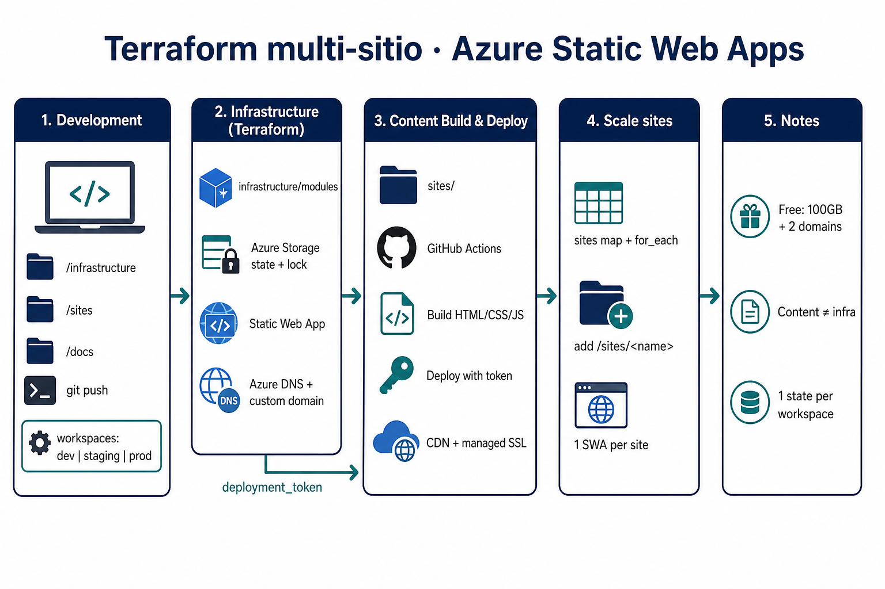

# Azure Static Sites · Terraform
Multi-site Terraform stack for **Azure Static Web Apps** (Free tier), with Azure DNS, remote state, **workspaces** for environments, and GitHub Actions content deploy via deployment tokens.

IaC lives under [`infrastructure/`](infrastructure/) so modules can be reused across implementations. Site content stays in [`sites/`](sites/).

Aligned with [docs/Readme-Terraform.md](docs/Readme-Terraform.md) (naming, modules, remote state, pinned providers, sensitive outputs, plan-before-apply).

## Architecture
### Azure (resources)


### Delivery flow (CI/CD)


```text
Developer → git push → GitHub Actions
                         ├─ Stage 1: Terraform (SWA + DNS + custom domains)
                         │            └─ Azure Storage state + blob lock
                         │            └─ workspace = dev|staging|prod
                         │            └─ outputs deployment_token
                         └─ Stage 2: Build & Deploy (token → SWA)
                                      └─ CDN + managed SSL
```

| Concept | Choice |
|---------|--------|
| Sites | `for_each` over a `sites` map — **1 SWA per site** |
| Environments | **Terraform workspaces** (`dev` / `staging` / `prod`) + matching `*.tfvars` |
| State | One blob per workspace under `env:/<workspace>/tf-{project}/terraform.tfstate` |
| Resource group | Shared per environment by default |
| DNS | Shared zone; create once (prod) or pass existing zone |
| Content | Deployed with GHA + `deployment_token` (not GitHub App linking) |

## Repository layout
```text
├── infrastructure/             # All Terraform (reusable package)
│   ├── modules/
│   │   ├── static_web_app/
│   │   └── dns_zone/
│   ├── scripts/                # Backend bootstrap
│   ├── main.tf / variables.tf / outputs.tf / …
│   ├── dev.tfvars / staging.tfvars / prod.tfvars
│   └── backend.hcl.example
├── sites/                      # Static content per site
├── docs/                       # Azure architecture + delivery diagrams
├── .github/workflows/
├── Makefile                    # Runs terraform inside infrastructure/
└── README.md
```

## Prerequisites
- Terraform `1.15.x` (see [`infrastructure/.terraform-version`](infrastructure/.terraform-version))
- Azure CLI (`az login`) with rights to create RG / SWA / DNS / Storage
- GitHub repo + Actions enabled
- A domain you can delegate to Azure DNS (or an existing Azure DNS zone)

## Naming convention
Pattern for workload resources: `tf-{environment}-{project_name}-{resource}`  
Pattern for shared backend (no env): `tf-{project_name}-{resource}`

| Resource | Pattern | Example |
|----------|---------|---------|
| Backend RG | `tf-{project}-tfstate-rg` | `tf-staticsites-tfstate-rg` |
| Backend storage | `tf{project}tfstate` (no hyphens; Azure SA limit) | `tfstaticsitestfstate` |
| Shared RG | `tf-{env}-{project}-rg` | `tf-dev-staticsites-rg` |
| Static Web App | `tf-{env}-{project}-swa-{site}` | `tf-dev-staticsites-swa-site1` |
| Per-site RG (optional) | `tf-{env}-{project}-rg-{site}` | `tf-dev-staticsites-rg-site1` |
| Tags (required) | `environment`, `managed-by=terraform`, `project` | |
| Workspace | must equal `environment` in the tfvars | `dev` + `dev.tfvars` |

## Free tier limits and Standard upgrade
| Limit | Free | When to use Standard |
|-------|------|----------------------|
| Custom domains / SWA | **2** | Need 3+ domains on one app |
| Bandwidth | 100 GB / month / app | Sustained traffic above Free |
| SSL | Managed | Same |
| Auth / SLA | Limited | Enterprise features |

**How to scale a site to Standard:** in the env tfvars set `sku_tier = "Standard"` on that site, then `make plan ENV=...` / `make apply ENV=...`.

Validation blocks reject Free + more than 2 `custom_domains`. Checks also fail if the active workspace does not match `var.environment`, or if you are on `default`.

## Bootstrap remote state (one-time)
```powershell
.\infrastructure\scripts\bootstrap-backend.ps1 -ProjectName staticsites -Location eastus2
```

```bash
./infrastructure/scripts/bootstrap-backend.sh --project-name staticsites --location eastus2
```

Creates:
- RG `tf-staticsites-tfstate-rg`
- Storage `tfstaticsitestfstate` (Azure no permite guiones en storage accounts)
- Container `tfstate`

```bash
cp infrastructure/backend.hcl.example infrastructure/backend.hcl
# edit if needed; key = tf-staticsites/terraform.tfstate
```

## Configure and apply
1. Edit `infrastructure/dev.tfvars` (and staging/prod) — set `project_name`, `dns_zone_name`, and `sites`.
2. Replace placeholder domains (`example.com`) with yours.
3. Prefer **one** workspace (usually prod) with `create_dns_zone = true`; others set `create_dns_zone = false` and `existing_dns_zone_resource_group_name`.
4. From repo root:

```bash
make fmt
make init
make workspace ENV=dev
make plan ENV=dev          # review infrastructure/tfplan-dev
make apply ENV=dev         # applies the saved plan only
```

After apply, delegate registrar NS to `terraform output dns_name_servers` (from `infrastructure/`, when this stack created the zone).

### Export deployment tokens to GitHub
```bash
cd infrastructure
terraform workspace select dev
terraform output -json deployment_tokens
```

Create repository secrets (never commit these):

| Secret | Value |
|--------|--------|
| `AZURE_STATIC_WEB_APPS_API_TOKEN_SITE1` | `deployment_tokens.site1` |
| `AZURE_STATIC_WEB_APPS_API_TOKEN_SITE2` | `deployment_tokens.site2` |
| `AZURE_CLIENT_ID` / `AZURE_TENANT_ID` / `AZURE_SUBSCRIPTION_ID` | OIDC for Terraform job |
| `TF_BACKEND_RESOURCE_GROUP` / `TF_BACKEND_STORAGE_ACCOUNT` | Backend bootstrap values |

## Add a new site
1. Add a folder under `sites/<key>/` with at least `index.html` (and optional `staticwebapp.config.json`).
2. Add an entry to `sites` in each relevant `infrastructure/*.tfvars`:

```hcl
sites = {
  # ...existing...
  marketing = {
    display_name    = "Marketing"
    custom_domains  = ["www.example.com"]  # max 2 on Free
    app_location    = "/sites/marketing"
    sku_tier        = "Free"
  }
}
```

3. Add a matrix row in [`.github/workflows/azure-static-web-apps.yml`](.github/workflows/azure-static-web-apps.yml) and a matching GitHub secret.
4. `make plan ENV=...` → review → `make apply ENV=...`.
5. Store the new `deployment_token` in GitHub Secrets.

## Content vs infrastructure
- Changes under `infrastructure/` → Terraform stage.
- Changes under `sites/<name>/` → deploy job for that site only.
- You can update HTML/CSS/JS without re-running Terraform once the SWA exists.

## Optional Azure Functions API
Set `api_location` on the site (e.g. `"api"`) and add Functions under that path. See [sites/README.md](sites/README.md). Keep APIs lightweight on Free.

## Apex domains
Subdomains use CNAME → `default_host_name` + `cname-delegation`.  
Apex (`example.com`) uses `dns-txt-token` + `asuid` TXT. You may still need an ALIAS/A record to the SWA hostname (Azure DNS alias) — see [infrastructure/modules/static_web_app/README.md](infrastructure/modules/static_web_app/README.md).

## Makefile targets
| Target | Description |
|--------|-------------|
| `make fmt` | `terraform fmt -recursive` in `infrastructure/` |
| `make init` | Init with `infrastructure/backend.hcl` if present |
| `make workspace ENV=dev` | Create/select workspace |
| `make plan ENV=dev` | Plan with `dev.tfvars` → `infrastructure/tfplan-dev` |
| `make apply ENV=dev` | Apply saved plan only |
| `make destroy ENV=dev` | Interactive destroy (no auto-approve) |

## Security notes
- Mark sensitive outputs (`deployment_tokens`, validation tokens) — do not print in CI logs.
- Do not commit `backend.hcl`, `*.auto.tfvars`, or state files (see [`.gitignore`](.gitignore)).
- Prefer OIDC federated credentials over long-lived client secrets for Actions.
- Least-privilege: separate SP for Terraform vs content deploy tokens.

## Modules
- [infrastructure/modules/dns_zone](infrastructure/modules/dns_zone/README.md)
- [infrastructure/modules/static_web_app](infrastructure/modules/static_web_app/README.md)

## Terraform best practices checklist
See [docs/Readme-Terraform.md](docs/Readme-Terraform.md) for the full list. This repo implements: descriptive naming, isolated `infrastructure/modules/` + workspaces, remote state + lock, pinned providers / `.terraform-version`, documented variables/outputs, sensitive flags, fmt/validate, and plan file before apply.