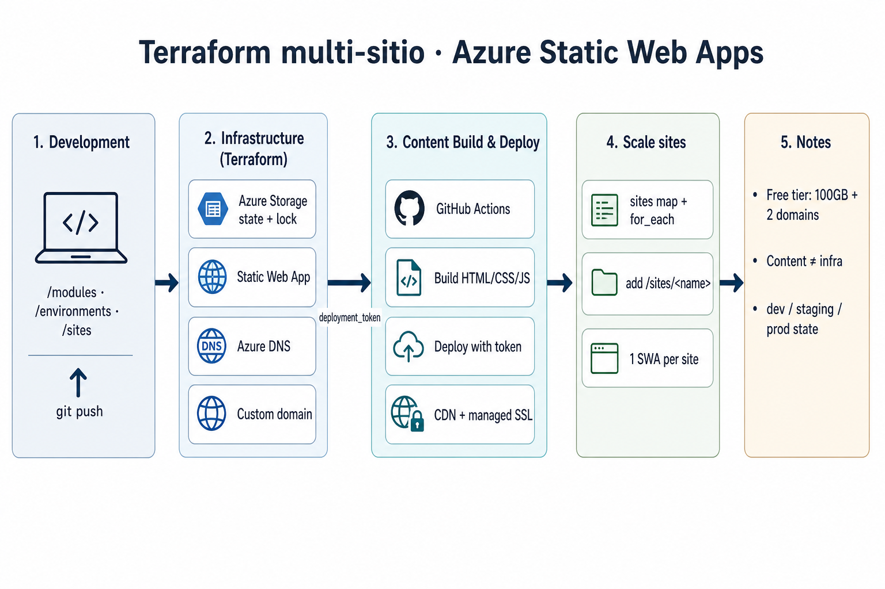

# Azure Static Sites · Terraform

Multi-site, multi-environment Terraform stack for **Azure Static Web Apps** (Free tier), with Azure DNS, remote state, and GitHub Actions content deploy via deployment tokens.

Aligned with [Readme-Terraform.md](Readme-Terraform.md) (naming, modules, remote state, pinned providers, sensitive outputs, plan-before-apply).

## Architecture



```text
Developer → git push → GitHub Actions
                         ├─ Stage 1: Terraform (SWA + DNS + custom domains)
                         │            └─ Azure Storage state + blob lock
                         │            └─ outputs deployment_token
                         └─ Stage 2: Build & Deploy (token → SWA)
                                      └─ CDN + managed SSL
```

| Concept | Choice |
|---------|--------|
| Sites | `for_each` over a `sites` map — **1 SWA per site** |
| State | **One state file per environment**: `{project}/{environment}/terraform.tfstate` |
| Resource group | Shared per environment by default |
| DNS | Shared zone; create once (prod) or pass existing zone |
| Content | Deployed with GHA + `deployment_token` (not GitHub App linking) |

## Repository layout

```text
├── modules/
│   ├── static_web_app/     # SWA + custom domains + DNS records
│   └── dns_zone/           # Azure DNS zone (optional create)
├── environments/
│   ├── dev|staging|prod/   # Separate roots + separate state
├── sites/                  # Example static content per site
├── scripts/                # Backend bootstrap (bash + PowerShell)
├── .github/workflows/      # Infra + content pipelines
├── Makefile
├── .terraform-version
└── .pre-commit-config.yaml
```

## Prerequisites

- Terraform `1.15.x` (see [`.terraform-version`](.terraform-version))
- Azure CLI (`az login`) with rights to create RG / SWA / DNS / Storage
- GitHub repo + Actions enabled
- A domain you can delegate to Azure DNS (or an existing Azure DNS zone)

## Naming convention

| Resource | Pattern | Example |
|----------|---------|---------|
| Shared RG | `rg-{project}-{environment}` | `rg-staticsites-dev` |
| Static Web App | `{project}-{environment}-{site}` | `staticsites-dev-site1` |
| Per-site RG (optional) | `rg-{swa-name}` | `rg-staticsites-dev-site1` |
| Tags (required) | `environment`, `managed-by=terraform`, `project` | |

## Free tier limits and Standard upgrade

| Limit | Free | When to use Standard |
|-------|------|----------------------|
| Custom domains / SWA | **2** | Need 3+ domains on one app |
| Bandwidth | 100 GB / month / app | Sustained traffic above Free |
| SSL | Managed | Same |
| Auth / SLA | Limited | Enterprise features |

**How to scale a site to Standard:** in `terraform.tfvars` set `sku_tier = "Standard"` on that site object, then `make plan ENV=...` / `make apply ENV=...`. Terraform updates `sku_tier` / `sku_size` in place. Document billing impact before applying to prod.

Validation blocks reject Free + more than 2 `custom_domains`.

## Bootstrap remote state (one-time)

Azure Storage backend with blob lease locking:

```powershell
.\scripts\bootstrap-backend.ps1 `
  -ResourceGroup tfstate-rg `
  -Location eastus2 `
  -StorageAccount sttfstateproj001 `
  -Container tfstate
```

```bash
./scripts/bootstrap-backend.sh \
  --resource-group tfstate-rg \
  --location eastus2 \
  --storage-account sttfstateproj001 \
  --container tfstate
```

Then per environment:

```bash
cp environments/dev/backend.hcl.example environments/dev/backend.hcl
# edit resource_group_name, storage_account_name, key
```

Key format: `{project}/{environment}/terraform.tfstate` (e.g. `staticsites/dev/terraform.tfstate`).

## Configure and apply

1. Edit `environments/<env>/terraform.tfvars` — set `project_name`, `dns_zone_name`, and `sites`.
2. Replace placeholder domains (`example.com`) with yours.
3. Prefer **one** environment (usually prod) with `create_dns_zone = true`; others set `create_dns_zone = false` and `existing_dns_zone_resource_group_name`.
4. Run:

```bash
make fmt
make init ENV=dev
make plan ENV=dev          # review environments/dev/tfplan
make apply ENV=dev         # applies the saved plan only
```

After apply, delegate registrar NS to `terraform output dns_name_servers` (when this stack created the zone).

### Export deployment tokens to GitHub

```bash
cd environments/dev
terraform output -json deployment_tokens
```

Create repository secrets (never commit these):

| Secret | Value |
|--------|--------|
| `AZURE_STATIC_WEB_APPS_API_TOKEN_SITE1` | `deployment_tokens.site1` |
| `AZURE_STATIC_WEB_APPS_API_TOKEN_SITE2` | `deployment_tokens.site2` |
| `AZURE_CLIENT_ID` / `AZURE_TENANT_ID` / `AZURE_SUBSCRIPTION_ID` | OIDC for Terraform job |
| `TF_BACKEND_RESOURCE_GROUP` / `TF_BACKEND_STORAGE_ACCOUNT` | Backend bootstrap values |

## Add a new site

1. Add a folder under `sites/<key>/` with at least `index.html` (and optional `staticwebapp.config.json`).
2. Add an entry to `sites` in the environment `terraform.tfvars`:

```hcl
sites = {
  # ...existing...
  marketing = {
    display_name    = "Marketing"
    custom_domains  = ["www.example.com"]  # max 2 on Free
    app_location    = "/sites/marketing"
    sku_tier        = "Free"
  }
}
```

3. Add a matrix row in [`.github/workflows/azure-static-web-apps.yml`](.github/workflows/azure-static-web-apps.yml) and a matching GitHub secret.
4. `make plan ENV=...` → review → `make apply ENV=...`.
5. Store the new `deployment_token` in GitHub Secrets.

## Content vs infrastructure

- Changes under `modules/` or `environments/` → Terraform stage.
- Changes under `sites/<name>/` → deploy job for that site only.
- You can update HTML/CSS/JS without re-running Terraform once the SWA exists.

## Optional Azure Functions API

Set `api_location` on the site (e.g. `"api"`) and add Functions under that path. See [sites/README.md](sites/README.md). Keep APIs lightweight on Free.

## Apex domains

Subdomains use CNAME → `default_host_name` + `cname-delegation`.  
Apex (`example.com`) uses `dns-txt-token` + `asuid` TXT. You may still need an ALIAS/A record to the SWA hostname (Azure DNS alias) — see [modules/static_web_app/README.md](modules/static_web_app/README.md).

## Makefile targets

| Target | Description |
|--------|-------------|
| `make fmt` | `terraform fmt -recursive` |
| `make init ENV=dev` | Init with `backend.hcl` if present |
| `make plan ENV=dev` | Plan → `tfplan` (review before apply) |
| `make apply ENV=dev` | Apply saved `tfplan` only |
| `make destroy ENV=dev` | Interactive destroy (no auto-approve) |

## Pre-commit

```bash
pre-commit install
pre-commit run --all-files
```

Hooks: `terraform_fmt`, `terraform_validate`, `terraform_tflint`, `gitleaks`.

## Security notes

- Mark sensitive outputs (`deployment_tokens`, validation tokens) — do not print in CI logs.
- Do not commit `backend.hcl`, `*.auto.tfvars`, or state files (see [`.gitignore`](.gitignore)).
- Prefer OIDC federated credentials over long-lived client secrets for Actions.
- Least-privilege: separate SP for Terraform vs content deploy tokens.

## Modules

- [modules/dns_zone](modules/dns_zone/README.md)
- [modules/static_web_app](modules/static_web_app/README.md)

## Terraform best practices checklist

See [Readme-Terraform.md](Readme-Terraform.md) for the full list. This repo implements: descriptive naming, `modules/` + `environments/`, remote state + lock, pinned providers / `.terraform-version`, documented variables/outputs, sensitive flags, fmt/validate/pre-commit, and plan file before apply.
