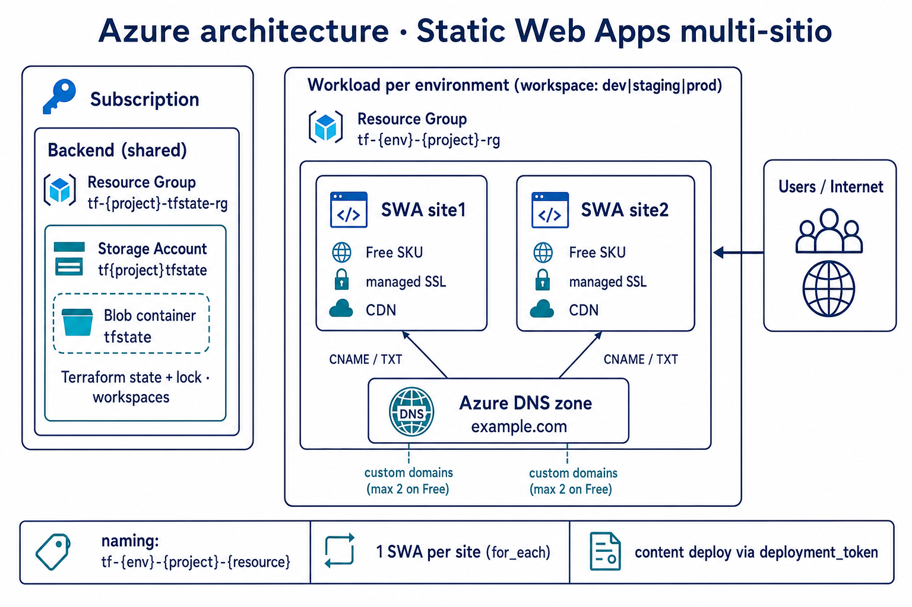

# Infrastructure (Terraform)
Reusable Azure Static Web Apps stack: root module, workspaces, and modules.

## Layout
```text
infrastructure/
├── modules/
│   ├── static_web_app/
│   └── dns_zone/
├── scripts/                 # One-time remote-state bootstrap
├── main.tf                  # Root: RG + for_each sites
├── variables.tf / outputs.tf / providers.tf / backend.tf
├── dev.tfvars / staging.tfvars / prod.tfvars
└── backend.hcl.example
```

## Usage (from repo root)
```bash
make init
make workspace ENV=dev
make plan ENV=dev
make apply ENV=dev
```

Or from this folder:
```bash
terraform init -backend-config=backend.hcl
terraform workspace select dev   # or: terraform workspace new dev
terraform plan -var-file=dev.tfvars
```

## Reuse in another repo
Copy `infrastructure/` (or only `modules/`) into another implementation, point `source` at the modules, and supply your own `*.tfvars`. Site content (`sites/`) stays outside this package.

See the root [README.md](../README.md) for naming, Free-tier limits, and CI/CD.

## Azure architecture


Delivery flow: [diagram.jpeg](../docs/diagram.jpeg)